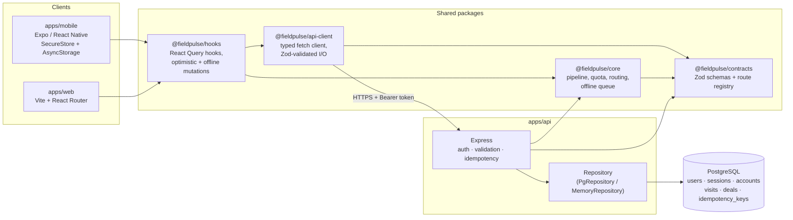

# FieldPulse

FieldPulse is a sales tool for field reps that runs on phones and in the browser. Reps plan
the day's visits, check in at accounts with GPS, log outcomes and follow-ups, and move deals
through a pipeline while tracking quota. The mobile app keeps working without a connection.
Managers use the same tools and can see the whole team's data.

It is a **Turborepo monorepo** written in TypeScript:

- **React Native (Expo)** mobile app and a **React (Vite)** web app share all domain logic,
  API contracts, the HTTP client and the data-fetching hooks.
- **Zod** schemas in one package make up the API contract. The server validates every request
  with them, and the clients validate every request and response with the same schemas.
- **PostgreSQL** stores the business data and the login sessions (opaque tokens, stored hashed,
  that can be revoked).
- **GitHub Actions** runs lint, typecheck, test and build for every package, checks the
  migrations against a real Postgres, and builds release artifacts.

## Features

| Area | What it does |
|---|---|
| Today | Today's visits ordered into a driving route from your current GPS position (nearest-neighbour + 2-opt), overdue follow-ups, and accounts overdue for a visit based on their tier (A: 14d, B: 30d, C: 60d) |
| Visits | Check in, record the outcome, notes and a follow-up date, and capture the GPS location to confirm you were on site |
| Pipeline | Kanban view of six stages with enforced stage transitions, a required reason when a deal is lost, optimistic concurrency (`expectedUpdatedAt`), and weighted pipeline and win rate |
| Quota | Quarter-to-date attainment, projected attainment (closed won plus weighted open deals that close this quarter), and days remaining |
| Offline | Mobile changes made offline go into a persistent FIFO queue and replay in order with `Idempotency-Key`s, so a retry never applies a change twice |
| Sessions | Every device gets its own server-side session with sliding expiry. You can list and revoke devices from Settings |

## Architecture



The same `canTransition()` and `summarizePipeline()` functions from `@fieldpulse/core` run on
the server, which enforces them and computes `/pipeline/summary`, and on the client, which uses
them to decide which buttons to show and to recompute the pipeline optimistically while
offline. Server and clients therefore always agree.

```
FieldPulse/
├── apps/
│   ├── api/          Express API, SQL migrations, seed script, Dockerfile
│   ├── mobile/       Expo app (Today, Accounts, Pipeline, Settings, Log visit)
│   └── web/          Vite app (Dashboard board, Accounts, Visits, Settings)
├── packages/
│   ├── contracts/    Zod schemas + typed route registry
│   ├── core/         Pure domain logic + offline queue
│   ├── api-client/   Contract-validating HTTP client
│   └── hooks/        React Query hooks shared by both apps
├── .github/workflows/  ci.yml, release.yml
├── docker-compose.yml  Local Postgres
└── turbo.json
```

## Running locally

Prerequisites: Node 20+, npm 10+, and Docker (for Postgres). To run the mobile app you also
need the Expo Go app on a phone, or an iOS simulator / Android emulator.

```bash
# 1. Install all workspaces
npm install

# 2. Start Postgres
docker compose up -d db

# 3. Configure env files
cp apps/api/.env.example apps/api/.env
cp apps/web/.env.example apps/web/.env
cp apps/mobile/.env.example apps/mobile/.env   # set your LAN IP for a physical device

# 4. Build shared packages, create the schema and load demo data
npx turbo run build --filter="./packages/*"
npm run db:migrate
npm run db:seed

# 5. Run everything (API :4000, web :5173, Expo dev server)
npm run dev
```

Or run one app at a time:

```bash
npm run dev --workspace @fieldpulse/api
npm run dev --workspace @fieldpulse/web
npm run dev --workspace @fieldpulse/mobile   # press i / a, or scan the QR code with Expo Go
```

Demo logins (the password is `SEED_PASSWORD`, `fieldpulse-demo` by default):
`riley@fieldpulse.dev` (rep), `sam@fieldpulse.dev` (rep), `manager@fieldpulse.dev` (manager).

### Environment variables

| App | Variable | Purpose |
|---|---|---|
| api | `DATABASE_URL` | Postgres connection string |
| api | `DATABASE_SSL` | `true` for managed Postgres that requires TLS |
| api | `SESSION_TTL_HOURS` | Idle session lifetime (slides on use; default 14 days) |
| api | `CORS_ORIGINS` | Comma-separated allowed web origins |
| api | `SEED_PASSWORD` | Password for the seeded demo users |
| web | `VITE_API_URL` | API base URL |
| mobile | `EXPO_PUBLIC_API_URL` | API base URL. On a phone, use your machine's LAN IP; on the Android emulator, use `http://10.0.2.2:4000` |

No secrets are committed. Copy the `.env.example` files and fill them in.

### Docker (API)

```bash
docker build -f apps/api/Dockerfile -t fieldpulse-api .
docker run --rm -e DATABASE_URL=... fieldpulse-api node dist/migrate.js   # release step
docker run -p 4000:4000 -e DATABASE_URL=... fieldpulse-api
```

## Testing

```bash
npm test             # turbo runs vitest in every package that has tests
npm run typecheck    # tsc --noEmit across all workspaces
npm run lint
```

The tests do not need a database:

- `packages/contracts`: schema refinements (follow-up rules, lost-reason rule, query
  coercion, path building).
- `packages/core`: stage transitions, weighted pipeline, quarter and quota math, route
  planning, visit cadence, formatting, and offline queue ordering, retry and drop behaviour.
- `packages/api-client`: auth headers, query strings, client-side validation,
  `ContractError` on schema drift, error mapping, 401 handling, idempotency keys.
- `apps/api`: supertest suites against `MemoryRepository` covering login, hashed token
  storage, sliding expiry, session revocation, scoping reps vs. managers, visit completion,
  idempotent replay, illegal stage moves, optimistic-concurrency conflicts and the pipeline
  summary.

The `migrations` job in CI applies `apps/api/migrations` to a Postgres 16 service container
twice (to prove reruns are idempotent) and seeds it. To check them locally, run
`npm run db:migrate` against the docker-compose database.

## CI/CD

- **`ci.yml`** (push/PR): format check, then `turbo run lint typecheck test build` with a
  cached `.turbo` directory. It also runs the migration and seed job against Postgres, and an
  `expo export` of the mobile bundle to catch Metro resolution errors in the monorepo.
- **`release.yml`** (tags `v*.*.*`): pushes the API image to GHCR, uploads the web build as an
  artifact, and, when `vars.EAS_ENABLED` is `true` and the `EXPO_TOKEN` secret is set,
  starts EAS builds for iOS and Android.
- **Dependabot** sends weekly npm updates (grouped) and monthly GitHub Actions updates.
